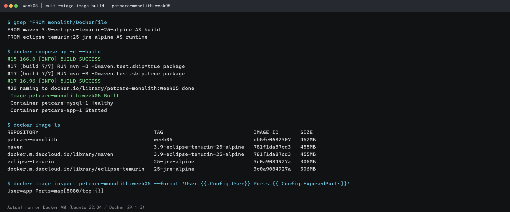
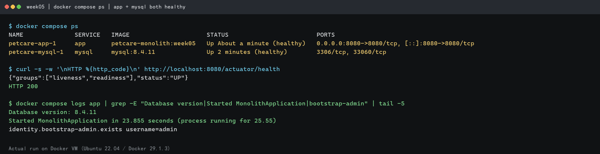
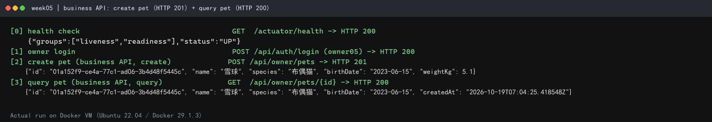
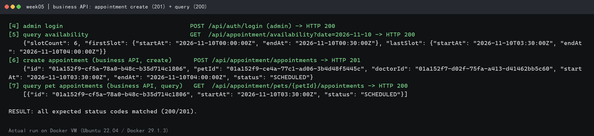
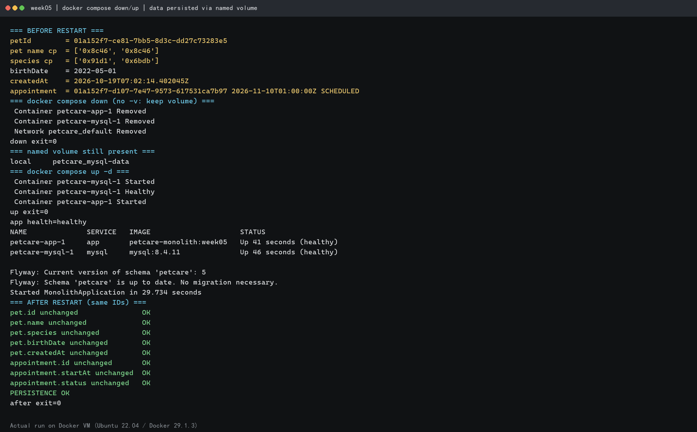

# 第 05 周作业：Dockerfile 与 Compose 容器化

> 题目：个人 Spring Boot 单体项目与 MySQL 数据库容器化，实现可重复的镜像构建、一键启动、业务 API 验证和数据持久化。
> 工程：`monolith/`（PetCare，Java 25 + Spring Boot 4.0.8，模块化单体）。
> 镜像：`petcare-monolith:week05`；数据库镜像：`mysql:8.4.11`。

| 部分 | 产出 |
|---|---|
| Dockerfile 与镜像构建 | `monolith/Dockerfile`、`monolith/.dockerignore` |
| Compose 编排与启动 | 根目录 `compose.yaml`、`.env.example`、`.gitignore` |
| 业务 API 验证 | `README.md`「Docker Compose 一键启动」；owner / pet 接口 |
| 数据持久化 | 命名卷 `petcare_mysql-data`；`down` 后重新 `up` 再查询 |

> **验证状态**：已在本地 VMware Docker 主机（Ubuntu 22.04 / Docker 29.1.3 / Compose v5.5.1）完成镜像构建、Compose 启动、业务 API 与命名卷持久化验证。下方结果均为实测输出，截图位于 `screenshots/`。

---

## 1. Dockerfile 与镜像构建

### 实现思路

`monolith/Dockerfile` 采用多阶段构建，构建与运行环境分离：

| 阶段 | 基础镜像 | 作用 |
|---|---|---|
| `build` | `maven:3.9-eclipse-temurin-25-alpine` | 使用 Maven 下载依赖并打包可执行 JAR，本机无需安装 Maven/JDK |
| `runtime` | `eclipse-temurin:25-jre-alpine` | 只保留 JRE 与 JAR，以非 root 用户运行，减小体积与攻击面 |

关键点：

- 先复制 `pom.xml` 与 `docker/maven-settings.xml`，执行 `dependency:go-offline`，再复制 `src/`，依赖层可被 Docker 缓存复用。
- `docker/maven-settings.xml` 将 Maven Central 镜像到阿里云，避免受限网络下依赖下载过慢。
- 构建命令 `mvn -B -Dmaven.test.skip=true package`：跳过测试（测试依赖真实 MySQL），产出 Spring Boot 可执行 JAR。
- 运行阶段只复制 `target/monolith-*.jar`，不包含源码、Maven 缓存和测试依赖。
- 创建非 root 用户 `app`；安装 `curl` 仅用于 Compose 健康检查。
- `ENTRYPOINT` 使用 `exec java ...`，保证容器信号正确传递；`JAVA_OPTS` 可在运行时覆盖。

`monolith/.dockerignore` 排除：`target/`、`.env`/`.env.*`、`*.pem`/`*.key`、IDE 配置、`.git/`、Maven Wrapper、日志和本地 `docker-compose.yml`。密码文件与其他密钥不会进入构建上下文和镜像。

### 构建命令

在**仓库根目录**执行（本次实际通过 Compose 触发同一 Dockerfile 与构建上下文）：

```bash
docker compose up -d --build
# 等价于单独构建：
# docker build -t petcare-monolith:week05 ./monolith
```

查看镜像：

```bash
docker image ls petcare-monolith:week05
docker image inspect petcare-monolith:week05 --format 'User={{.Config.User}} Ports={{.Config.ExposedPorts}}'
```

### 执行结果（实测）

```text
$ grep ^FROM monolith/Dockerfile
FROM maven:3.9-eclipse-temurin-25-alpine AS build
FROM eclipse-temurin:25-jre-alpine AS runtime

$ docker compose up -d --build
#17 [build 7/7] RUN mvn -B -Dmaven.test.skip=true package
#17 16.96 [INFO] BUILD SUCCESS
#20 naming to docker.io/library/petcare-monolith:week05 done
 Image petcare-monolith:week05 Built
 Container petcare-mysql-1 Healthy
 Container petcare-app-1 Started

$ docker image ls
REPOSITORY          TAG                             IMAGE ID       SIZE
petcare-monolith    week05                          eb5fe0682307   452MB
maven               3.9-eclipse-temurin-25-alpine   781f1da87cd3   455MB
eclipse-temurin     25-jre-alpine                   3c0a9084927a   306MB

$ docker image inspect petcare-monolith:week05 --format 'User={{.Config.User}} Ports={{.Config.ExposedPorts}}'
User=app Ports=map[8080/tcp:{}]
```

多阶段构建成功，最终镜像 `452MB`，以非 root 用户 `app` 运行并暴露 `8080`。构建过程不需要 Docker 主机安装 Maven 或 JDK。



---

## 2. Compose 编排与启动

### 服务与连接方式

根目录 `compose.yaml`（无已废弃的 `version` 字段）包含两个服务：

| 服务 | 镜像 / 构建 | 端口 | 说明 |
|---|---|---|---|
| `mysql` | `mysql:8.4.11` | 仅容器网络 | 数据库，数据写入命名卷 `mysql-data` |
| `app` | 构建上下文 `./monolith` | `8080:8080`（可经 `APP_PORT` 修改） | Spring Boot 应用 |

- 两个服务加入 Compose 默认共享网络 `petcare_default`。
- 应用通过 **服务名 `mysql`** 连接数据库：`DB_HOST=mysql`、`DB_PORT=3306`。
- `app.depends_on.mysql.condition: service_healthy`：MySQL 健康检查通过后才启动应用。
- MySQL 健康检查：`mysqladmin ping`，间隔 5s，超时 5s，重试 20 次，启动宽限 30s。
- 应用健康检查：`curl -fsS http://localhost:8080/actuator/health/readiness`。
- MySQL 数据卷：`mysql-data`（Compose 项目名 `petcare`，实际卷名 `petcare_mysql-data`）。
- 重启策略：`unless-stopped`。

### 环境变量

根目录 `.env.example` 为模板，复制为 `.env` 使用（`.env` 已在 `.gitignore` 中忽略，禁止提交真实密码）：

```bash
cp .env.example .env
# 至少修改 DB_PASSWORD、MYSQL_ROOT_PASSWORD、JWT_SECRET（JWT_SECRET >= 32 字符）
```

| 变量 | 作用 | 示例 |
|---|---|---|
| `DB_NAME` | 数据库名 | `petcare` |
| `DB_USER` | 业务数据库账号（不能为 `root`） | `petcare` |
| `DB_PASSWORD` | 业务账号密码 | 自行设置 |
| `MYSQL_ROOT_PASSWORD` | MySQL root 密码 | 自行设置 |
| `DB_HOST` / `DB_PORT` | 应用连接地址 | `mysql` / `3306` |
| `JWT_SECRET` | JWT 签名密钥（>= 32 字符） | 自行设置 |
| `APP_PORT` | 应用映射到宿主机的端口 | `8080` |
| `BOOTSTRAP_ADMIN_*` | 可选，首次启动引导管理员 | `admin` 等 |

### 启动命令

在仓库根目录执行：

```bash
docker compose up -d --build
docker compose ps
docker compose logs -f app
```

查看解析后的完整配置（会把 `.env` 代入）：

```bash
docker compose config
```

### 执行结果（实测）

```text
$ docker compose ps
NAME              SERVICE   IMAGE                     STATUS                        PORTS
petcare-app-1     app       petcare-monolith:week05   Up About a minute (healthy)   0.0.0.0:8080->8080/tcp, [::]:8080->8080/tcp
petcare-mysql-1   mysql     mysql:8.4.11              Up 2 minutes (healthy)        3306/tcp, 33060/tcp

$ curl -s -w '\nHTTP %{http_code}\n' http://localhost:8080/actuator/health
{"groups":["liveness","readiness"],"status":"UP"}
HTTP 200

$ docker compose logs app | grep -E "Database version|Started MonolithApplication|bootstrap-admin"
Database version: 8.4.11
Started MonolithApplication in 23.855 seconds (process running for 25.55)
identity.bootstrap-admin.exists username=admin
```

两个服务均为 `healthy`；应用实际连接到 `jdbc:mysql://mysql:3306/petcare`，数据库版本 `8.4.11`。首次启动时 Flyway 执行 `V1`~`V5` 迁移，并由环境变量幂等创建管理员 `admin`。

> 启动日志中 Flyway 会提示 “Using MySQL 8.4 which is newer than the version Flyway has been verified with”；迁移校验与执行仍成功，属于版本提示而非错误。



---

## 3. 个人业务 API 验证

通过宿主机映射端口 `8080` 访问容器内应用。验证链路：健康检查 → 注册/登录 → 创建主人档案 → 创建宠物（创建接口）→ 查询宠物（查询接口）。

### 请求与预期结果

```bash
BASE=http://localhost:8080

# 0) 健康检查
curl -fsS $BASE/actuator/health
```

```json
{"groups":["liveness","readiness"],"status":"UP"}
```

```bash
# 1) 注册（公开）
curl -s -XPOST $BASE/api/auth/register -H 'Content-Type: application/json' \
  -d '{"username":"owner05","phone":"13800000505","password":"Str0ngPassw0rd!","displayName":"Owner 05"}'

# 2) 登录，取 access token
TOKEN=$(curl -s -XPOST $BASE/api/auth/login -H 'Content-Type: application/json' \
  -d '{"username":"owner05","password":"Str0ngPassw0rd!"}' \
  | grep -o '"accessToken":"[^"]*"' | cut -d'"' -f4)

# 3) 创建主人档案（业务接口）
curl -s -XPUT $BASE/api/owner/me -H "Authorization: Bearer $TOKEN" \
  -H 'Content-Type: application/json' \
  -d '{"name":"宋方壹","phone":"13800000505","address":"杭州"}'

# 4) 创建宠物（创建接口，HTTP 201）
PET_ID=$(curl -s -XPOST $BASE/api/owner/pets -H "Authorization: Bearer $TOKEN" \
  -H 'Content-Type: application/json' \
  -d '{"name":"豆豆","species":"金毛","birthDate":"2022-05-01","weightKg":28.5}' \
  | grep -o '"id":"[^"]*"' | head -1 | cut -d'"' -f4)
echo "$PET_ID"

# 5) 查询宠物（查询接口，HTTP 200）
curl -s $BASE/api/owner/pets/$PET_ID -H "Authorization: Bearer $TOKEN"
```

预期响应（`id`、时间字段为实际生成值）：

```json
{
  "id": "<uuidv7>",
  "ownerId": "<uuidv7>",
  "name": "豆豆",
  "species": "金毛",
  "birthDate": "2022-05-01",
  "weightKg": 28.50,
  "createdAt": "<timestamp>",
  "updatedAt": "<timestamp>"
}
```

> 截图时建议给 `curl` 加 `-i`（例如 `curl -i -XPOST ...`），以便清楚显示 `HTTP/1.1 200` / `201` 状态码。

覆盖的业务接口：

| 接口 | 方法 | 验证内容 |
|---|---|---|
| `/api/owner/me` | PUT | 创建主人档案 |
| `/api/owner/pets` | POST | 创建宠物（201） |
| `/api/owner/pets/{petId}` | GET | 按 ID 查询宠物（200） |
| `/actuator/health` | GET | 健康检查 |

### 执行结果（实测）

首次完整链路（宠物 `豆豆` / `金毛`）全部通过：注册 `201`、登录 `200`、主人档案 `200`、创建宠物 `201`、按 ID 查询 `200`、管理员创建医生 `201`、创建排班 `201`、查询可约时段 `200`、创建预约 `201`、查询预约 `200`。

用于截图的复验（宠物 `雪球` / `布偶猫`）：

```text
[0] health check                                   GET  /actuator/health -> HTTP 200
    {"groups":["liveness","readiness"],"status":"UP"}
[1] owner login                                    POST /api/auth/login (owner05) -> HTTP 200
[2] create pet (business API, create)              POST /api/owner/pets -> HTTP 201
    {"id": "01a152f9-ce4a-77c1-ad06-3b4d48f5445c", "name": "雪球", "species": "布偶猫", "birthDate": "2023-06-15", "weightKg": 5.1}
[3] query pet (business API, query)                GET  /api/owner/pets/{id} -> HTTP 200
    {"id": "01a152f9-ce4a-77c1-ad06-3b4d48f5445c", "name": "雪球", "species": "布偶猫", "birthDate": "2023-06-15", "createdAt": "2026-10-19T07:04:25.418548Z"}
[4] admin login                                    POST /api/auth/login (admin) -> HTTP 200
[5] query availability                             GET  /api/appointment/availability?date=2026-11-10 -> HTTP 200
    {"slotCount": 6, "firstSlot": {"startAt": "2026-11-10T00:00:00Z", "endAt": "2026-11-10T00:30:00Z"}, "lastSlot": {"startAt": "2026-11-10T03:30:00Z", "endAt": "2026-11-10T04:00:00Z"}}
[6] create appointment (business API, create)      POST /api/appointment/appointments -> HTTP 201
    {"id": "01a152f9-cf5a-78a0-b48c-b35d714c1806", "petId": "01a152f9-ce4a-77c1-ad06-3b4d48f5445c", "doctorId": "01a152f7-d02f-75fa-a413-d41462bb5c60", "startAt": "2026-11-10T03:30:00Z", "endAt": "2026-11-10T04:00:00Z", "status": "SCHEDULED"}
[7] query pet appointments (business API, query)   GET  /api/appointment/pets/{petId}/appointments -> HTTP 200
    [{"id": "01a152f9-cf5a-78a0-b48c-b35d714c1806", "startAt": "2026-11-10T03:30:00Z", "status": "SCHEDULED"}]

RESULT: all expected status codes matched (200/201).
```





---

## 4. 数据持久化验证

### 验证方法

1. 按第 3 节创建宠物，记录返回的 `PET_ID` 及 `name`、`species`、`birthDate`。
2. 删除容器但**不删除数据卷**：

```bash
docker compose down
docker volume ls | grep petcare_mysql-data
```

3. 重新启动（无需重新构建）：

```bash
docker compose up -d
# 等待健康检查通过
curl -fsS http://localhost:8080/actuator/health
```

4. 重新登录后，用**同一个 `PET_ID`** 查询：

```bash
TOKEN=$(curl -s -XPOST $BASE/api/auth/login -H 'Content-Type: application/json' \
  -d '{"username":"owner05","password":"Str0ngPassw0rd!"}' \
  | grep -o '"accessToken":"[^"]*"' | cut -d'"' -f4)
curl -s $BASE/api/owner/pets/$PET_ID -H "Authorization: Bearer $TOKEN"
```

判定标准：`id`、`name`、`species`、`birthDate` 与 `createdAt` 均与重建前一致，说明数据由命名卷保留而非存在于容器可写层。

### 命名数据卷的作用

`compose.yaml` 将 `mysql-data` 挂载到 MySQL 的 `/var/lib/mysql`。容器是可替换的计算单元，删除容器不会删除卷；只有 `docker compose down -v` 或显式 `docker volume rm` 才会删除数据。因此容器重建后 MySQL 仍能读取原数据目录，Flyway 也因 `flyway_schema_history` 已存在而跳过已执行迁移。

> **不要**在持久化验证中使用 `docker compose down -v`，该命令会删除数据卷。

### 执行结果（实测）

使用首次创建的宠物 `豆豆` 与预约 `2026-11-10T01:00:00Z` 验证：

```text
=== BEFORE RESTART ===
petId        = 01a152f7-ce81-7bb5-8d3c-dd27c73283e5
pet name cp  = ['0x8c46', '0x8c46']          # 豆豆
species cp   = ['0x91d1', '0x6bdb']          # 金毛
birthDate    = 2022-05-01
createdAt    = 2026-10-19T07:02:14.402045Z
appointment  = 01a152f7-d107-7e47-9573-617531ca7b97 2026-11-10T01:00:00Z SCHEDULED

=== docker compose down (no -v: keep volume) ===
 Container petcare-app-1 Removed
 Container petcare-mysql-1 Removed
 Network petcare_default Removed
down exit=0

=== named volume still present ===
local     petcare_mysql-data

=== docker compose up -d ===
 Container petcare-mysql-1 Healthy
 Container petcare-app-1 Started
up exit=0
app health=healthy

Flyway: Current version of schema 'petcare': 5
Flyway: Schema 'petcare' is up to date. No migration necessary.
Started MonolithApplication in 29.734 seconds

=== AFTER RESTART (same IDs) ===
pet.id unchanged               OK
pet.name unchanged             OK
pet.species unchanged          OK
pet.birthDate unchanged        OK
pet.createdAt unchanged        OK
appointment.id unchanged       OK
appointment.startAt unchanged  OK
appointment.status unchanged   OK
PERSISTENCE OK
after exit=0
```



---

## 6. 运行环境说明

本次验证在一台 Ubuntu 22.04 虚拟机中完成，该虚拟机仅作为 **Docker 宿主机**：

- Docker 29.1.3，Docker Compose v5.5.1，`ubuntu` 用户属于 `docker` 组。
- 仓库源码放在宿主机上，是为了向 Docker 提供 `./monolith` 构建上下文；Spring Boot 没有安装到 Ubuntu 系统。
- 宿主机没有安装 MySQL 服务；`mysql:8.4.11` 由 Compose 作为容器启动。
- 应用与数据库都运行在容器中，通过 `petcare_default` 网络通信，符合题目要求。

在任意已安装 Docker 的主机上，执行以下命令即可复现：

```bash
cp .env.example .env
vi .env                      # 修改 DB_PASSWORD、MYSQL_ROOT_PASSWORD、JWT_SECRET
docker compose up -d --build
docker compose ps
curl -fsS http://localhost:8080/actuator/health
```

> 若 Docker Hub 直连受限，可为 Docker 配置 registry mirror；本项目构建阶段的 Maven 依赖已通过 `docker/maven-settings.xml` 使用阿里云镜像。
