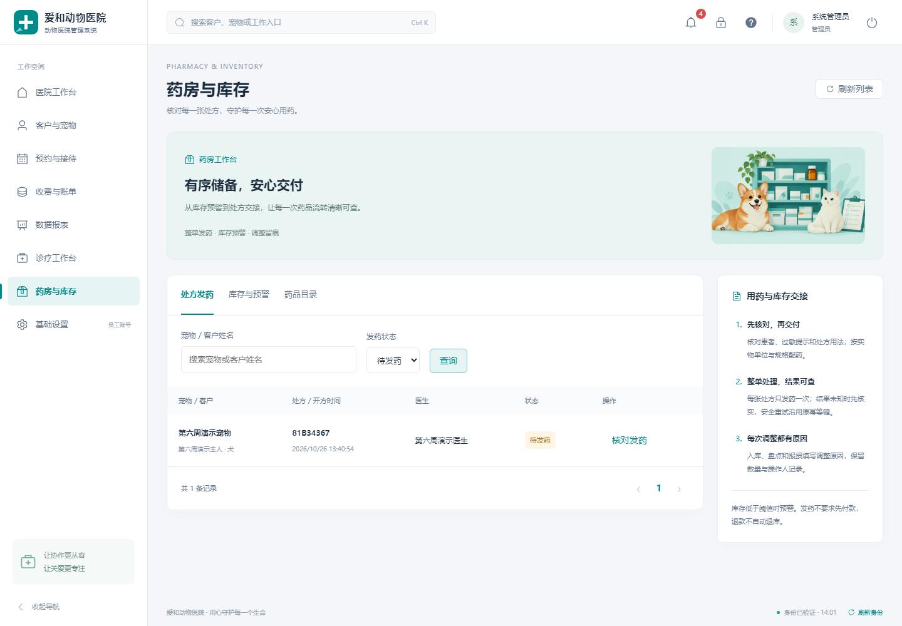
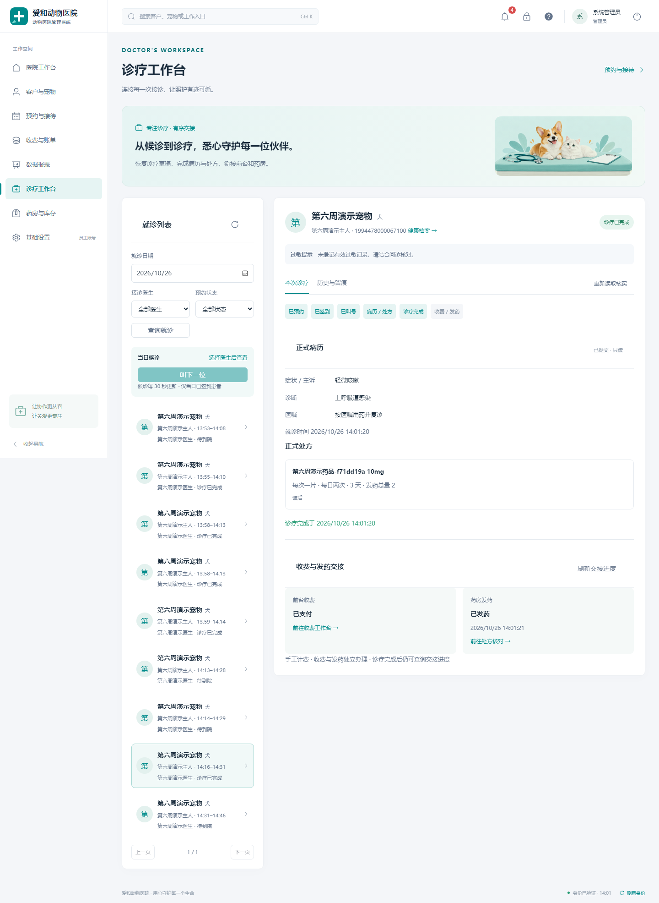
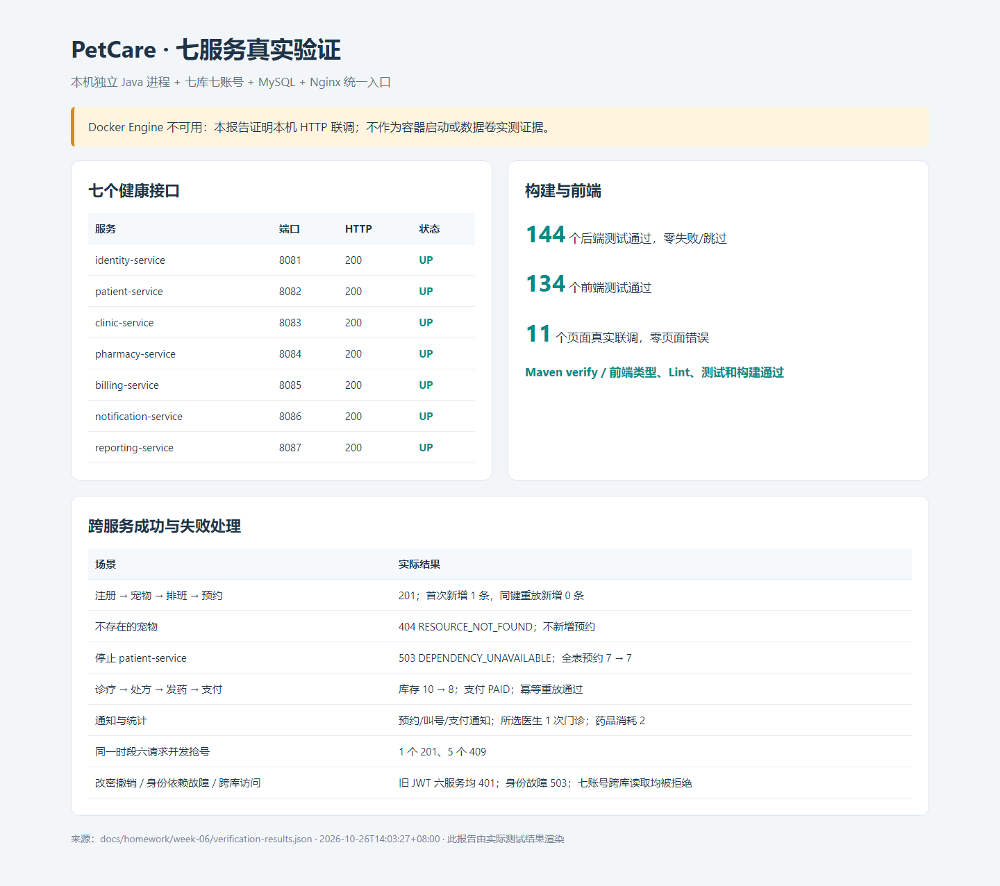
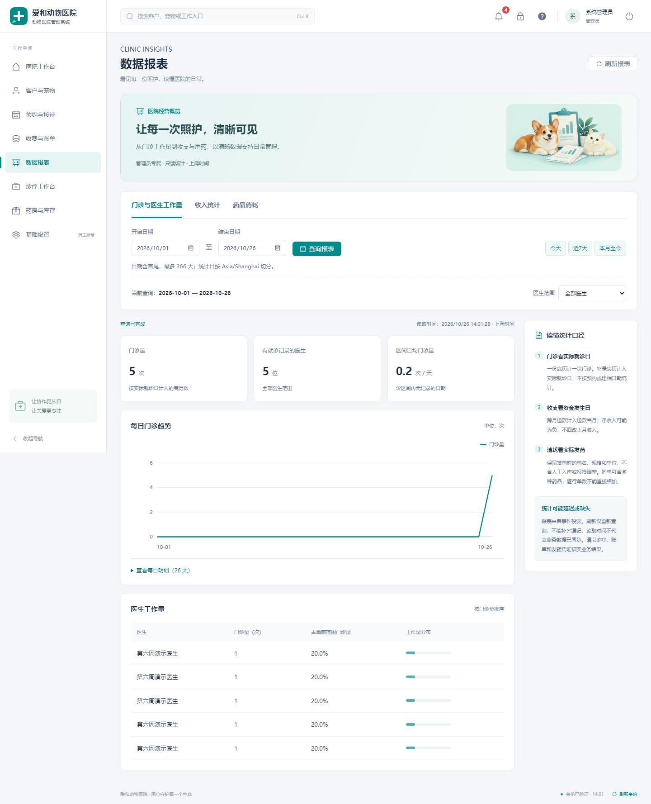
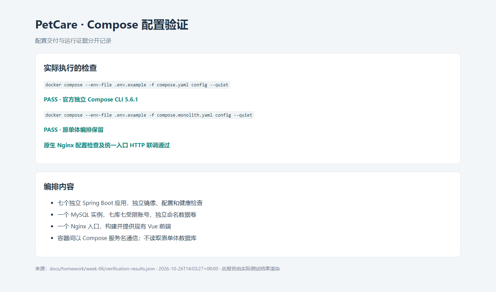

# 第 06 周：微服务拆分与 HTTP 协作


## 1. 服务拆分设计

将 PetCare 的全部业务迁入七个独立 Spring Boot 工程，保留 `monolith/` 和原单体数据库。身份、患者档案、诊疗、药房、收费、通知、报表各有数据库和账号。预约与病历共同组成诊疗服务，保留预约行锁与诊疗写入的本地事务关系；前端通过 Nginx 按原 API 路径访问微服务。

完整模块映射、全部表归属、端口、调用关系、Mermaid 架构图及事务边界见 [微服务设计](../../microservices-design.md)。独立工程位于根目录 `services/`，每个工程都有自己的 `pom.xml` 和 `src/`，业务代码基础包为 `com.zjgsu.sfy`。

关键结论：拆分依据业务与本地事务内聚性；跨服务只能通过 HTTP 读取最小 DTO，不跨库查询、不调用对方 Repository。共享幂等表改为诊疗、药房、收费各自拥有。微服务使用新库和演示数据，不迁移单体历史。

> 已完成宠物医院七个微服务的服务边界和数据所有权设计，保留原单体，预约与诊疗合并以保留本地事务，其余业务各自独立部署。各服务独立数据库账号、跨服务使用 HTTP，架构图和全部表归属已记录在设计文档。

## 2. 代码拆分

七个服务使用 Java 25、Spring Boot 4.0.8，分别包含原业务的 Controller、Service、Repository、Entity，以及独立配置和迁移。公共接口/DTO 在使用它们的工程中保留线协议副本，没有共享业务实现 Jar、共享数据源或对单体工程的依赖。

跨服务读取通过 `RestTemplate` 完成。连接/读取超时默认 2/5 秒，服务地址和超时可通过环境变量覆盖。前置资源不存在返回 404，业务准入失败返回 409，连接失败、超时、5xx 或无效依赖响应返回 503，禁止跳过校验写入。中文搜索参数按 URI 编码一次。

身份服务签发并撤销会话，其他服务本地验证 JWT 后通过 HTTP 校验账号状态与会话版本；改密后的旧令牌不能继续使用。内部接口由服务令牌保护，统一入口不公开内部路径。

药房的待发列表通过 HTTP 分页读取已提交处方，更新本地索引后结合本地发药记录筛选，不依赖开方时的跨库事务。通知、报表通过提交后的 HTTP 推送生成本地读模型。

从仓库根目录执行：

```bash
mvn -B -f services/pom.xml test
mvn -B -f services/pom.xml verify
# 每个服务也可独立运行测试，例如：
mvn -f services/clinic-service/pom.xml test

cd frontend
npm ci
npm run check
```

实际结果：七个服务合计 **144 个测试通过，零失败、零跳过**；前端 **16 个测试文件、134 个测试通过**，类型检查、Lint 与构建通过；另外 **11 个页面**通过真实微服务 E2E。汇总保存在 [verification-results.json](verification-results.json)。服务测试包括原有领域约束、真实回环 HTTP 的 JSON/凭据/错误/连接拒绝/读取超时/中文参数测试，以及禁止混入其他服务持久化实现的架构测试。测试无需预先启动 MySQL；真实服务启动时另执行 Flyway 与 Hibernate 校验。

前端真实微服务联调：先运行完整业务脚本生成夹具，再通过环境变量提供隔离环境管理员账号：

```bash
E2E_MICROSERVICES=1 E2E_BASE_URL=http://localhost:8080 \
E2E_USERNAME="你的演示管理员" E2E_PASSWORD="你的演示密码" \
WEEK06_SCREENSHOTS_DIR=../docs/homework/week-06/screenshots \
npx playwright test e2e/microservices.spec.ts
```

上述命令在 `frontend/` 执行。测试没有网络 Mock，覆盖客户/宠物详情、预约、诊疗、药房、收费、报表、通知和员工账号相关共 11 个页面，检查真实 API 响应和页面错误状态。




## 3. 本地编排

根目录 `compose.yaml` 包含七个应用、`micro-mysql` 和 `gateway`。MySQL 初始化脚本为每个服务创建独立数据库和受限账号；数据库保存到命名卷。应用之间通过 `http://<服务名>:8080` 通信，只有容器自身健康检查使用 `localhost`。

Nginx 镜像从现有 Vue 源码构建前端，统一入口默认 `http://localhost:8080`，七个服务健康端口映射到宿主机回环地址 8081–8087。原单体编排原样保存在根目录 `compose.monolith.yaml`，继续使用原项目名和数据卷。

```bash
# 首次准备；已有 .env 时只合并新增配置，保留原凭据。
cp .env.example .env
# 设置 JWT_SECRET、SERVICE_TOKEN、MYSQL_ROOT_PASSWORD、七个 *_DB_PASSWORD 和管理员配置。
docker compose config --quiet
docker compose up -d --build --wait --wait-timeout 900
docker compose ps
docker compose logs --tail=50 clinic-service pharmacy-service billing-service

# 停止但保留数据
docker compose down
docker compose up -d --wait --wait-timeout 900
# 用原账号和记录 ID 查询，验证容器重建后数据保留。

# 单体版本（默认同为 8080，勿在端口冲突时同时启动）
docker compose -f compose.monolith.yaml up -d --build
```

## 4. 验证

### 4.1 健康、跨服务成功与失败

脚本只需要 Bash 和 Python 3.10+，可从仓库根目录运行：

```bash
bash scripts/smoke-test.sh --health-only
bash scripts/smoke-test.sh
GATEWAY_URL=http://localhost:8080 python scripts/microservices_workflow.py
```

默认脚本读取根目录 `.env` 的管理员配置；环境变量优先。每次使用新账号/医生/宠物，保留演示数据供复查。凭据和运行上下文只写入已忽略的 `.artifacts/`，公开结果文件不包含密码或令牌。

| 实际请求 / 场景 | 状态码 | 实际数据变化与断言 |
|---|---:|---|
| 七个服务 `GET /actuator/health` | 各 200 | 全部 `status=UP` |
| `POST /api/appointment/appointments`，有效宠物与医生排班 | 201 | 对应宠物预约 0 → 1 |
| 相同请求和 `Idempotency-Key` 重放 | 201 | 返回原预约 ID，仍为 1 条 |
| 随机不存在的宠物 ID 创建预约 | 404 | `RESOURCE_NOT_FOUND`，对应宠物预约数不变 |
| 停止 patient-service 后创建预约 | 503 | `DEPENDENCY_UNAVAILABLE`；诊疗库全表预约数实测 7 → 7 |
| 恢复 patient-service 后查询 | 200 | 原预约存在，没有失败请求新增记录 |
| 签到、叫号、保存诊疗草稿、提交病历处方及完成 | 各 200 | 本地预约状态、病历、处方与版本规则成立 |
| 药房查询待发处方、核对详情 | 200 | 能读到诊疗服务已提交处方及档案/过敏摘要 |
| `POST /api/pharmacy/prescriptions/{id}/dispense`，含同键重放 | 201 | 只产生同一发药记录，库存 10 → 8，重放仍为 8 |
| 创建账单、支付及同键支付重放 | 201 | 同一支付 ID，账单为 PAID，无重复支付 |
| 诊疗交接状态、宠物病历索引 | 200 | 能通过 HTTP 读到实际收费、发药及诊疗数据 |
| 通知与三类报表查询 | 200 | 主人收到预约/叫号/支付通知；所选医生门诊 1 次、所选药品消耗 2 盒/1 张发药单 |
| 六个不同幂等键并发预约同一新时段 | 1 个 201、5 个 409 | 仅新增 1 条，其他为 `APPOINTMENT_CONFLICT` |
| 管理员改密后旧 JWT 请求六个业务服务 | 各 401 | 旧会话均被拒绝，新密码登录后恢复访问 |
| 身份服务不可用，使用尚未失效 JWT 访问档案/诊疗 | 各 503 | 与失效凭据的 401 区分，关闭访问 |
| 各服务数据库账号尝试读取另一服务数据表 | MySQL 1142 | 七个账号均被拒绝跨库读取 |
| 重复投递已消费的预约、病历事件 | 200 | 通知和门诊事实的总行数均不变 |
| 内部接口缺少服务令牌 / 通过网关访问内部路径 | 401 / 404 | 七个服务要求内部凭据，统一入口拒绝内部路径 |
| 药房按中文宠物名筛选已发处方 | 200 | 能匹配当次处方，内部 HTTP 参数未发生二次编码 |

完整业务请求和资源 ID 见 [verification-results.json](verification-results.json)。记录中的全局演示数量可能包含排查过程中保留的独立测试数据；成功流程的库存、门诊、幂等与并发断言都针对当次唯一资源。

在 Compose 环境验证依赖停止/恢复：

```bash
# 先成功运行 smoke-test.sh，保留同一工作目录的 .artifacts 上下文。
docker compose stop patient-service
bash scripts/smoke-test.sh --dependency-failure
docker compose start patient-service
# 等待健康接口恢复 UP，再检查无新增预约。
bash scripts/smoke-test.sh --verify-restored
```

本轮实际使用停止/恢复隔离环境的 patient-service 进程完成同样故障注入，并直接使用诊疗库所属账号查询全表数量，没有用其他服务的账号进行业务跨库读写。

### 4.2 非原子窗口

本流程的必要远端调用首先是只读校验。远端读取成功、本地事务失败时，本地预约/账单/发药记录不会提交；远端没有业务写入需要撤销。但校验通过后宠物归档或医生停用的状态变化仍可能发生，这是已确认的“校验时有效”语义。

通知/报表属于另一种窗口：核心业务提交后才推送，发送前宕机会遗漏；接收方成功提交后响应丢失，则发送方可能认为失败。消费幂等负责防重复，本周没有自动补投递或跨服务回滚。处方成功但发药失败、发药成功但收费失败，也保留各服务已提交状态，由工作台核实。

### 4.3 截图与真实证据

以下截图来自真实运行的现有前端或依据实际命令/请求结果渲染的验证报告，运行环境为本机进程、MySQL 和 Nginx。Compose 相关截图仅记录实际执行的配置验证结果。





