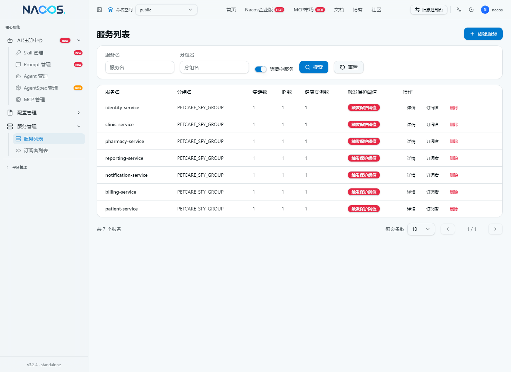
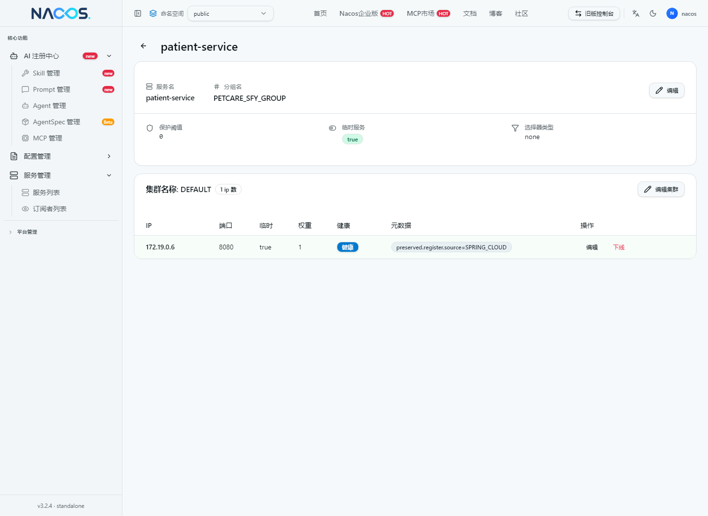
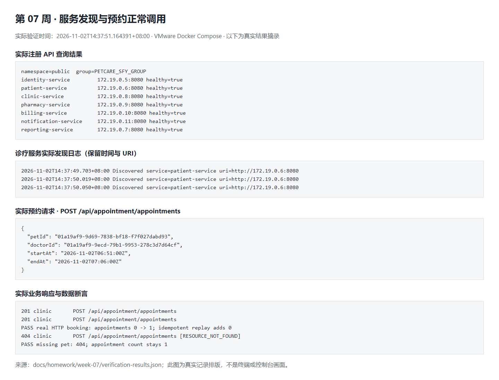
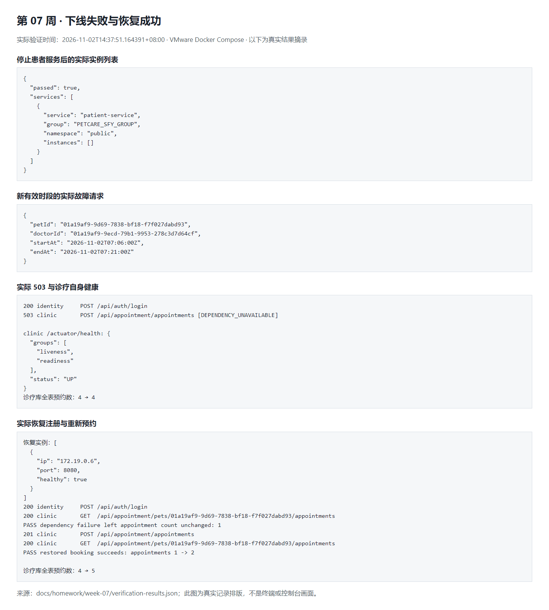
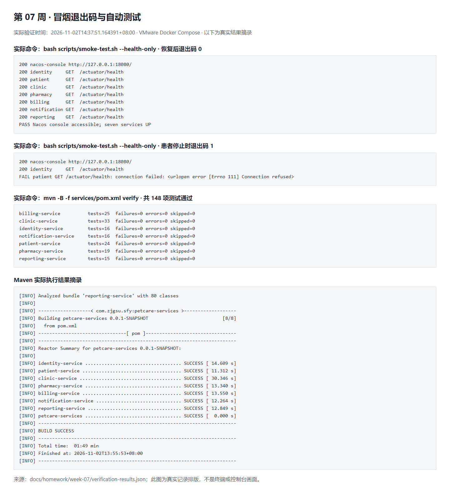

# 第 07 周：Nacos 注册、服务发现与上下线验证

仓库：[microservices-practice-2412190732](https://github.com/1164571767/microservices-practice-2412190732)

实际验证时间：`2026-11-02T14:37:51.164391+08:00`。继续修改原 `services/` 七个独立工程，保留 `com.zjgsu.sfy`、原接口、业务规则、各自数据归属和本地事务。完整边界见 [微服务设计](../../microservices-design.md)。本页所有状态码、实例地址和数据数量来自真实 VMware Docker 环境；结构化结果见 [verification-results.json](verification-results.json)。

## 1. 部署、初始化与注册

Java 25、Spring Boot 4.0.8 保持原版本；导入 Spring Cloud `2025.1.0` 和 Spring Cloud Alibaba `2025.1.0.0` BOM，添加 Discovery Starter，不覆盖 Nacos Client、不引入 Config Starter。实际解析的 Nacos Client 为 BOM 管理的 3.1.1，已与指定的 Nacos Server 3.2.4 实测注册和调用成功。

本机另有历史 Nacos 1.4.1，本周保留该安装，使用根目录 `compose.yaml` 中的 `nacos/nacos-server:v3.2.4`。实际运行在 VMware Ubuntu 22.04（2 CPU、4GiB 内存、100GiB 磁盘），复用第六周 Compose 项目和原微服务数据库卷。前端实际使用 `APP_PORT=18090`；新环境默认 8080。业务健康端口为宿主机回环地址 8081–8087，容器业务监听端口都是 8080。

Nacos 开启客户端、Admin 和控制台鉴权。Token 签名密钥为至少 32 个随机字节的 Base64，Server identity 键值为独立随机值；真实值和管理员密码仅保存在本地 `.env`，`.env.example` 只提交占位模板。控制台 `127.0.0.1:18080 → 8080`，服务端 `127.0.0.1:8848 → 8848`，SDK gRPC `127.0.0.1:9848 → 9848`，均未发布到公网。

首次操作顺序（仓库根目录）：

```bash
cp .env.example .env  # 仅首次；已有 .env 合并新增字段，不覆盖原密码
# 填写模板中的数据库、JWT、内部令牌、引导管理员及 Nacos 字段
docker compose config --quiet
docker compose up -d --wait --wait-timeout 300 nacos
python3 scripts/nacos-check.py --initialize
# 也可在 http://127.0.0.1:18080/ 完成首次初始化；两种方式选一种
docker compose up -d --build --wait --wait-timeout 900
python3 scripts/nacos-check.py --wait 120
docker compose ps
```

本次先独立启动 Nacos，通过初始化接口设置 `.env` 中的随机管理员密码，再重启 Nacos并使用相同凭据登录成功，验证 `nacos-data:/home/nacos/data` 中的初始化数据持久化；日志使用独立 `nacos-logs` 卷。随后从各自源码构建并启动七个业务镜像，十个容器（七服务、Nacos、MySQL、网关）均为 healthy。后续无需重复初始化，也不得为重置密码删除原业务卷。

在控制台选择默认命名空间 `public`，服务管理 → 服务列表，可查看 `PETCARE_SFY_GROUP`。命名空间配置留空；自定义时必须先创建并填写实际 Namespace ID。七个业务服务使用各自 `spring.application.name`，相同服务的多实例应保持同名，不同业务服务禁止共用名称。

| 服务名 | 分组 | 本次实际实例地址 | Nacos 实例状态 |
|---|---|---|---|
| identity-service | PETCARE_SFY_GROUP | 172.19.0.5:8080 | healthy |
| patient-service | PETCARE_SFY_GROUP | 172.19.0.6:8080 | healthy |
| clinic-service | PETCARE_SFY_GROUP | 172.19.0.8:8080 | healthy |
| pharmacy-service | PETCARE_SFY_GROUP | 172.19.0.9:8080 | healthy |
| billing-service | PETCARE_SFY_GROUP | 172.19.0.10:8080 | healthy |
| notification-service | PETCARE_SFY_GROUP | 172.19.0.11:8080 | healthy |
| reporting-service | PETCARE_SFY_GROUP | 172.19.0.7:8080 | healthy |

远程查看回环控制台可用 `ssh -L 18080:127.0.0.1:18080 ubuntu@<虚拟机IP>` 后访问本机 18080。控制台地址不是旧版 `8848/nacos`。




作业系统第 1 题说明：

> 在原宠医通七个独立微服务中接入 Nacos 3.2.4，先独立启动并初始化管理员，再启动业务服务。七服务均注册到 public 命名空间的 PETCARE_SFY_GROUP，控制台为本机 18080，服务端和 SDK 分别使用 8848、9848；鉴权和独立持久化数据卷已验证。

## 2. 服务发现与真实预约调用

选择“创建预约前校验宠物及所属档案有效状态”：`clinic-service → patient-service`。`PatientHttpClient` 每次请求通过 `DiscoveryClient.getInstances("patient-service")` 获取当前已知实例，选择其中一个并使用其 URI 加原 `/internal/patients/**` 路径发起 HTTP 请求。实际日志显示 `http://172.19.0.6:8080`，不是 Compose DNS 固定地址或仅把服务名写进普通 RestTemplate URL。

诊疗服务已删除 `PATIENT_SERVICE_URL`、`services.patient-url` 和对应属性。其他调用保留现有配置。所有服务的 Nacos 地址、用户名、密码、分组、命名空间均由环境变量读取，Compose 内地址为 `nacos:8848`。保留连接 2 秒、读取 5 秒超时及内部令牌保护，不增加轮询、权重、自动重试或熔断。

空列表、发现异常及旧地址连接失败返回 `503 DEPENDENCY_UNAVAILABLE`；资源不存在保留 `404 RESOURCE_NOT_FOUND`，合法的 409 等业务响应继续保留。禁止依赖失败后跳过校验落库。新的空列表和重新寻址测试模拟 DiscoveryClient；另以真实回环 HTTP 和本地数据库证明校验中途实例消失时不会新增预约。

运行 `bash scripts/smoke-test.sh` 自动创建当次独立主人、宠物、医生和有效排班。使用登录返回的令牌及新的幂等键调用：

```http
POST http://127.0.0.1:8083/api/appointment/appointments
Authorization: Bearer <本地登录令牌，不提交>
Content-Type: application/json
Idempotency-Key: <本次全新幂等键>

{
  "petId": "01a19af9-9d69-7838-bf18-f7f027dabd93",
  "doctorId": "01a19af9-9ecd-79b1-9953-278c3d7d64cf",
  "startAt": "2026-11-02T06:51:00Z",
  "endAt": "2026-11-02T07:06:00Z"
}
```

实际返回 201，预约 ID 为 `01a19af9-aa10-7767-b9f5-04bacf9f2f68`，当次宠物预约数 `0 → 1`；同键重放仍返回 201 和同一资源，不重复增加。随机不存在宠物返回 404，当次宠物预约数仍为 1。



作业系统第 2 题说明：

> 本次选择预约前校验宠物档案流程，由 clinic-service 每次通过 DiscoveryClient 查询 patient-service 的当前已知实例，统一使用 public 命名空间和 PETCARE_SFY_GROUP。本次发现地址为 172.19.0.6:8080，随后请求原内部档案接口，预约返回 201；不存在宠物返回 404，无实例或连接失败返回 503，校验失败不会继续保存预约。

## 3. 健康、下线与恢复

```bash
docker compose stop patient-service
python3 scripts/nacos-check.py --service patient-service --expect-count 0 --wait 120
bash scripts/smoke-test.sh --dependency-failure

docker compose start patient-service
python3 scripts/nacos-check.py --service patient-service --expect-count 1 --wait 120
curl -fsS http://127.0.0.1:8082/actuator/health
bash scripts/smoke-test.sh --verify-restored
bash scripts/smoke-test.sh --health-only
```

故障请求使用同一有效宠物、同一有效医生排班内的另一个未占用时段和全新幂等键，避免旧请求幂等重放或时段冲突掩盖依赖故障：

```json
{
  "petId": "01a19af9-9d69-7838-bf18-f7f027dabd93",
  "doctorId": "01a19af9-9ecd-79b1-9953-278c3d7d64cf",
  "startAt": "2026-11-02T07:06:00Z",
  "endAt": "2026-11-02T07:21:00Z"
}
```

| 实际场景 | 状态与结果 | 数据核对 |
|---|---|---|
| 全部正常，首次预约 | 201 | 当次宠物 0 → 1 |
| 同键重放 | 201，同一 ID | 当次宠物保持 1 |
| 不存在宠物 | 404 RESOURCE_NOT_FOUND | 当次宠物保持 1 |
| 停止 patient-service，等待注册列表变化 | 当前健康实例列表为空 | 查询注册 API 已断言实例数为 0 |
| 新有效时段预约 | 503 DEPENDENCY_UNAVAILABLE | 诊疗库全表预约数 4 → 4 |
| 患者停止时查询诊疗自身健康 | 200，UP | 诊疗进程及其数据库仍健康 |
| 患者恢复并重新注册 | 1 个 healthy 实例，健康接口 200 UP | 失败请求未新增，当次宠物仍为 1 |
| 恢复后使用失败时段及新幂等键预约 | 201 | 当次宠物 1 → 2，全表 4 → 5 |

全表检查通过 `micro-mysql` 容器中的诊疗专属账号 `svc_clinic` 查询所属库，密码从容器环境读取且未输出：

```sql
SELECT COUNT(*) FROM petcare_clinic.appointment;
```

此 SQL 只用于隔离环境验收，不引入业务跨库访问。恢复后先检查失败未新增，再发起新预约，不能把原有预约查询成功当成恢复写入成功。

以本系统为例：SDK 连接存活表示诊疗客户端还能与 Nacos 通信，不表示患者 HTTP 接口正常；注册实例健康是 Nacos 注册表视角，停止服务后可能有传播延迟，客户端也可能短暂保留旧地址；Actuator 是应用自身及其本地数据库的检查。患者停止时诊疗 Actuator 仍为 UP，而预约必须返回 503。不得假设 Actuator DOWN 会自动使 Nacos 摘除实例。

服务发现没有消除跨服务的非原子窗口：预约前置校验仍是校验时有效；本地提交后通知/报表推送仍可能部分成功或遗漏。不实现自动补偿或分布式事务，不宣称跨服务写操作整体回滚。



作业系统第 3 题说明：

> 停止 patient-service 后注册实例变为空，新预约返回 503，诊疗库预约总数 4→4；恢复注册和应用健康后重新预约成功，总数 4→5。SDK 连通、注册实例状态与应用自身 Actuator 健康含义不同，不能认为 Actuator DOWN 会自动摘除实例。

## 4. 脚本、测试与整体验证

仓库根目录运行：

```bash
bash scripts/smoke-test.sh
bash scripts/smoke-test.sh --health-only
python3 scripts/nacos-check.py --wait 120
# 隔离演示环境完整上下线验证，会短暂停止并恢复 patient-service：
bash scripts/verify-week07.sh
```

`smoke-test.sh` 先检查实际 Nacos 控制台 HTTP 200 和七个 `/actuator/health` 的 UP，再执行预约、重放和 404。任一连接、状态或业务断言失败都返回非零；本次患者停止时实际返回退出码 **1**，恢复后的健康检查及完整上下线验证脚本退出码 **0**。控制台可打开只证明控制台可用，预约请求及数据检查已另行实测。

各工程进入自身目录执行测试，不需要真实 Nacos 或 MySQL；测试配置关闭 Nacos 注册，远程响应用模拟 HTTP。命令：

```bash
(cd services/identity-service && mvn -B test)
(cd services/patient-service && mvn -B test)
(cd services/clinic-service && mvn -B test)
(cd services/pharmacy-service && mvn -B test)
(cd services/billing-service && mvn -B test)
(cd services/notification-service && mvn -B test)
(cd services/reporting-service && mvn -B test)
mvn -B -f services/pom.xml verify
```

本次实际执行聚合 `verify`，包括测试、打包、Spotless、ArchUnit 数据所有权检查、Enforcer 和覆盖率报告，**148 项测试通过，零失败、零错误、零跳过**。七个服务镜像另在 VMware 从源码构建成功。Bash 语法检查与原数据库初始化脚本回归也通过。

| 服务 | 测试数 | 失败 | 错误 | 跳过 |
|---|---:|---:|---:|---:|
| billing-service | 25 | 0 | 0 | 0 |
| clinic-service | 33 | 0 | 0 | 0 |
| identity-service | 16 | 0 | 0 | 0 |
| notification-service | 16 | 0 | 0 | 0 |
| patient-service | 24 | 0 | 0 | 0 |
| pharmacy-service | 19 | 0 | 0 | 0 |
| reporting-service | 15 | 0 | 0 | 0 |



截图 01–02 为真实 Nacos 控制台直接截图；03–05 为真实 API、命令日志和测试报告的排版摘录，明确标注来源，不伪装为终端或控制台。截图与公开结果文件均未包含密码、Token 或真实密钥。

作业系统第 4 题说明：

> 从仓库根目录执行 bash scripts/smoke-test.sh，检查 18080 控制台、七服务健康及实际预约行为。患者下线时健康检查退出 1，恢复后退出 0；完整上下线脚本还核对预约总数，七服务 Maven verify 共 148 项测试全部通过。

## 5. 当前边界

仅将诊疗到患者档案的调用改为服务发现，其他现有调用与数据归属保持原样。每次查询的是 SDK 当前已知实例，不承诺注册中心传播实时完成；旧地址失败同样按 503 处理。当前只选择一个实例，不提供多实例负载均衡、自动重试、熔断、配置中心或跨服务事务保证。关键不变量已由新增测试保护，并同步现有微服务设计，不重复新建独立 Harness。
