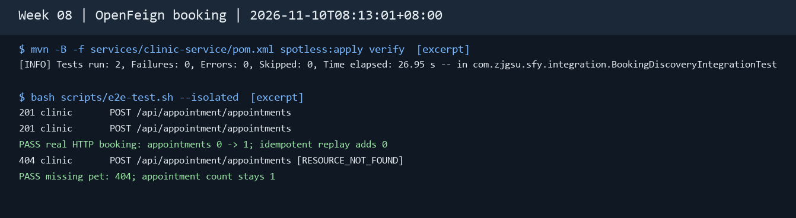
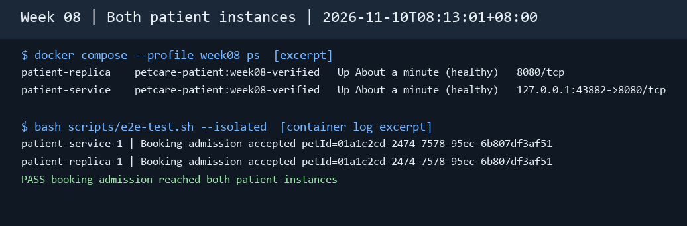
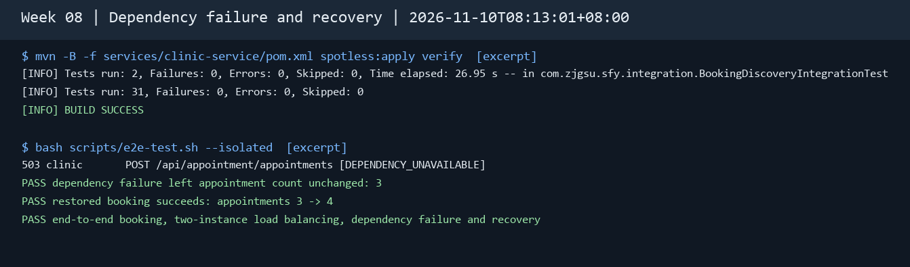

# 第 08 周：OpenFeign 同步调用与双实例验证

公开仓库：[microservices-practice-2412190732](https://github.com/1164571767/microservices-practice-2412190732)

实测日期为 2026-11-10（Asia/Shanghai），使用 Ubuntu 上的独立 Compose 项目及独立 Nacos、MySQL 数据卷。Docker Hub 基础镜像下载未完成，本次把通过 Maven 验证的诊疗和患者 JAR 封装到虚拟机已有的 Java 25 运行镜像中，再通过根目录 Compose 启动。截图为实际命令输出的摘录。

## 1. 选择一个跨服务业务流程

选择宠医通的「创建预约前校验宠物档案」。`clinic-service` 负责预约规则和写入，`patient-service` 负责宠物、所属档案和归档状态。用户调用 `POST /api/appointment/appointments` 后，诊疗服务先通过 `GET /internal/patients/pets/{id}` 获取档案，再调用 `POST /internal/patients/pets/{id}/admission` 校验有效性。任一校验失败都会阻止新预约落库。[同步调用链路图](../../service-communication.md)

运行第 4 节的脚本。实测首次预约返回 `201` 和预约 JSON，记录数从 0 到 1。同键重放返回同一 ID，记录数保持为 1。随机不存在的宠物返回 `404 RESOURCE_NOT_FOUND`，记录数仍为 1。

## 2. 使用 OpenFeign

诊疗服务用 `@FeignClient(name = "patient-service")` 声明原患者内部 API。Nacos 提供地址，Spring Cloud LoadBalancer 按调用选址。Feign 客户端通过 `X-Service-Token` 认证，沿用 2 秒连接超时和 5 秒读取超时，关闭重试。内部校验成功返回 `204`，档案状态拒绝保留 `409`，无实例、超时和上游错误返回 `503 DEPENDENCY_UNAVAILABLE`。

从仓库根目录运行 `mvn -B -f services/clinic-service/pom.xml verify`，验证真实 Feign 请求的 HTTP 方法、路径、令牌及 `204`、`409` 和无实例时的 `503`。端到端业务结果见第 4 节。



## 3. 负载均衡验证

`compose.yaml` 的 `week08` profile 启动 `patient-replica`。它与 `patient-service` 使用相同的患者镜像、患者数据库和 Nacos 应用名 `patient-service`。主实例默认映射回环地址 `8082`，副实例只监听容器网络中的 `8080`。

准备独立演示项目的根目录 `.env`，按 `.env.example` 设置数据库、JWT、内部令牌、演示管理员和 Nacos 凭据。首次运行先初始化 Nacos。宿主机已有同类项目时，用 Compose 覆盖文件改用空闲端口，并在 `.env` 中设置对应的 `NACOS_API_URL`、`IDENTITY_SERVICE_URL`、`PATIENT_SERVICE_URL` 和 `CLINIC_SERVICE_URL` 供验收脚本使用。

```bash
export COMPOSE_PROJECT_NAME=petcare-week08-demo
docker compose --profile week08 config --quiet
docker compose up -d --wait --wait-timeout 900 nacos
python3 scripts/nacos-check.py --initialize  # 仅首次
docker compose --profile week08 build identity-service patient-service clinic-service
docker compose --profile week08 up -d --no-build --wait --wait-timeout 600 clinic-service patient-replica
docker compose --profile week08 ps
```

第 4 节脚本先确认注册名下存在两个健康实例，再用本次生成的宠物 ID 分别查找两个容器里的成功校验日志。只有两个容器都实际处理过预约校验，脚本才继续执行停机测试。

本次三次成功的预约档案校验由 `patient-service-1` 处理两次、`patient-replica-1` 处理一次。两组日志中的宠物 ID 与本次脚本创建的演示宠物一致。



## 4. 测试

在仓库根目录执行以下命令。端到端脚本会暂停两个患者实例并创建演示档案和预约，请在独立演示环境运行。

```bash
mvn -B -f services/clinic-service/pom.xml verify
mvn -B -f services/patient-service/pom.xml verify
bash scripts/e2e-test.sh --isolated
```

脚本使用有效宠物、有效排班、未占用时段和新幂等键验证依赖故障。患者实例全部停用后，预约应返回 `503 DEPENDENCY_UNAVAILABLE`。恢复后先核对该宠物的预约数，确认失败请求没有写入，再用同一时段和新幂等键创建预约。服务层测试还模拟了宠物查询后、前置校验前实例消失的情况，并检查本地数据未变。

| 实际检查 | 结果 |
| --- | --- |
| 诊疗服务 `mvn verify` | 31 个测试通过，包含 2 个 Feign 与预约集成测试 |
| 患者服务 `mvn verify` | 24 个测试通过 |
| 两个患者实例停止 | Nacos 健康实例数从 2 变为 0，预约返回 `503 DEPENDENCY_UNAVAILABLE` |
| 恢复两个实例 | Nacos 健康实例数恢复为 2，重新读取预约列表仍为 3 条 |
| 恢复后重试原时段 | 返回 `201`，预约数从 3 增至 4，端到端脚本退出码为 0 |



本流程中的档案校验只读。客户端等待预约写入响应超时时，服务端可能已经提交，结果未知。可使用原请求和原幂等键重放，或查询预约列表确认。

## 作业系统填写文本

1. **选择一个跨服务业务流程**。宠医通创建预约需要诊疗服务查询宠物归属，再向患者服务校验宠物和所属档案的有效状态。档案校验成功后才能进入诊疗库的本地事务。实测首次预约返回 201，同键重放返回原预约，档案缺失返回 404，患者依赖全部停机时返回 503，失败预约没有新增记录。
2. **使用 OpenFeign**。诊疗服务通过服务名 `patient-service` 调用患者内部接口，由 Nacos 提供实例。集成测试验证请求路径、内部鉴权、业务拒绝与 503 映射。上传 `01-openfeign.png`。
3. **负载均衡验证**。启用 `week08` profile 启动两个患者实例。同一演示宠物的三次预约档案校验由主实例处理两次、副实例处理一次，两个容器都有成功处理日志。上传 `02-load-balancing.png`。
4. **测试**。55 个 Maven 测试通过，端到端脚本退出码为 0。停止两个患者实例后预约返回 503，恢复后确认预约数仍为 3，重试成功后增至 4。上传 `03-tests.png`。
