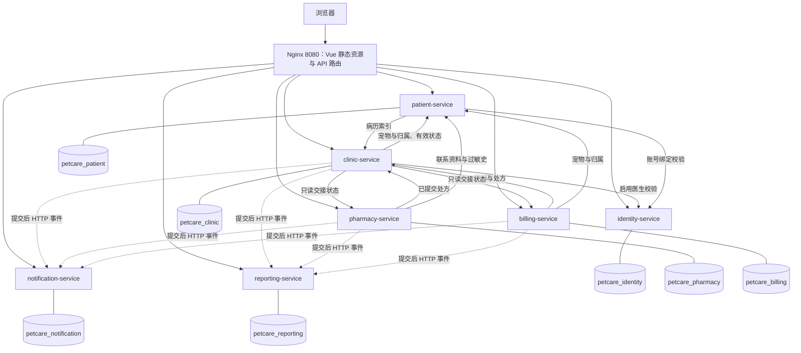

# PetCare 微服务设计（第 06 周）

## 1. 目标与已确认边界

将现有宠物医院的全部业务迁入七个独立 Spring Boot 应用，并让现有 Vue 前端通过统一入口访问。保留 `monolith/` 和原数据库作为单体版本；微服务使用全新数据库与演示数据，不迁移历史记录、不双写、不把单体作为运行依赖。

每个 `services/<服务名>/` 都有独立 `pom.xml`、`src/`、配置、迁移、测试与 Dockerfile，可单独构建。`services/pom.xml` 仅聚合构建，服务之间没有 Maven 工程依赖。基础包保持 `com.zjgsu.sfy`，业务实现位于子包。Java 25、Spring Boot 4.0.8 沿用当前单体。

本次是保留两个可运行版本的全量重构，不是线上逐步切流。旧 ADR-0013 基于 V1–V9 的提取评估仍作为历史分析保留；其中优先提取药房、先引入可靠事件基座的建议不构成本周实施前置。本周明确接受基础 HTTP 推送的遗漏窗口。

## 2. 模块映射与数据所有权

表中为宿主机默认端口。Compose 内所有 Spring Boot 容器监听 8080，通过服务名访问；每个服务使用独立账号，只有所属库的权限。`flyway_schema_history` 也分别归各服务所有。

| 独立工程 | 原模块与职责 | 端口 | 数据库 / 账号 | 拥有的数据表 |
|---|---|---:|---|---|
| `identity-service` | identity：注册登录、角色、员工账号、会话撤销及审计 | 8081 | `petcare_identity` / `svc_identity` | `users`、`user_role`、`refresh_token`、`identity_management_guard`、`identity_account_audit` |
| `patient-service` | owner：主人、宠物、健康档案、归档、账号绑定 | 8082 | `petcare_patient` / `svc_patient` | `owner`、`pet`、`vaccination`、`allergy`、`owner_operation` |
| `clinic-service` | appointment + medical：排班、预约接待、候诊、病历、处方、诊疗完成 | 8083 | `petcare_clinic` / `svc_clinic` | `doctor_schedule`、`appointment`、`schedule_guard`、`appointment_schedule_history`、`schedule_operation`、`medical_record`、`prescription`、`prescription_item`、`medical_consultation`、`medical_consultation_operation`、`idempotency_record` |
| `pharmacy-service` | pharmacy：药品、库存、待发处方索引、发药 | 8084 | `petcare_pharmacy` / `svc_pharmacy` | `drug`、`inventory`、`inventory_adjustment`、`dispense_record`、`dispense_item`、`pharmacy_prescription_task`、`idempotency_record` |
| `billing-service` | billing：收费项目、账单、模拟支付、退款及作废 | 8085 | `petcare_billing` / `svc_billing` | `charge_item`、`bill`、`bill_item`、`payment_record`、`bill_operation`、`idempotency_record` |
| `notification-service` | notification：通知查询、已读状态、复诊提醒 | 8086 | `petcare_notification` / `svc_notification` | `notification` |
| `reporting-service` | reporting：门诊、收入和药品消耗的统计读模型 | 8087 | `petcare_reporting` / `svc_reporting` | `reporting_visit_fact`、`reporting_revenue_fact`、`reporting_drug_consumption_fact` |

预约和病历保留两个内部模块，共同构成诊疗服务。现有病历写入与预约状态修改共享预约行锁，将它们放在同一服务可保留这部分事务规则。库存扣减与发药记录在药房本地事务内，账单状态、支付、幂等记录及审计在收费本地事务内。

主人与宠物共享档案生命周期，因此不再拆成两个服务。通知和报表是各有数据、各有查询接口的派生业务，各自独立部署。

## 3. 架构图

实线箭头是 HTTP 查询，虚线箭头是业务提交后的 HTTP 推送。所有受保护业务请求还会通过身份服务校验会话版本；通知读取档案与身份资料，复诊提醒读取诊疗记录，报表查询可补充医生姓名。这些辅助读取未逐一画出。

读状态可能形成双向依赖，但没有相互等待的跨服务写事务。内部接口只返回最小 DTO，不返回 Entity、Repository 或数据库连接信息。

## 4. API、认证与 HTTP 约束

Nginx 按现有 `/api/auth/**`、`identity`、`owner`、`appointment`、`medical`、`pharmacy`、`billing`、`notification`、`reporting` 路由。外部 API 与前端内存会话机制保持兼容，前端不维护七套地址。开发模式的 Vite `/api` 代理也指向这个入口。

服务之间由明确的 `IdentityHttpClient`、`PatientHttpClient`、`ClinicHttpClient`、交接客户端调用资源接口，例如：

- `POST /internal/identity/sessions/validate`：核对账号启用状态及会话版本。
- `POST /internal/identity/doctors/{id}/admission`：校验启用医生。
- `POST /internal/patients/pets/{id}/admission`：校验宠物与所属主人档案有效。
- `GET /internal/clinic/prescriptions/{id}`：读取已提交处方摘要。
- `GET /internal/clinic/prescription-index?page=0&size=100`：分页读取处方交接索引。
- `POST /internal/events/BillPaid` 等：消费允许的具体事件类型，不接受任意类名或动态反射调用。

所有客户端使用 `RestTemplate`，连接超时默认 2 秒、读取超时默认 5 秒；URL、超时和服务令牌在各自 `application.yml` 中声明，可通过环境变量覆盖。普通业务写请求不自动重试。集合分页使用显式 JSON DTO，避免跨进程直接序列化 Spring Data 的分页实现。中文搜索参数只编码一次。

各服务本地验证 JWT 签名、签发者、有效期及 access 类型，然后通过 HTTP 核对身份服务的账号状态和 `sv` 会话版本；不缓存这项检查。旧会话返回 401，身份依赖不可用返回 503，保留原系统的改密/停用后撤销会话语义。已进入执行的请求不追溯撤销。

内部接口要求至少 32 字符的 `SERVICE_TOKEN`，不经过 JWT 会话查询，避免认证递归。用户发起的内部调用可携带原始用户令牌用于诊断；业务授权与资源归属由入口业务服务执行，内部只读接口信任经服务令牌认证的调用方。Nginx 不公开 `/internal/**`，也清除外部传入的 `X-Service-Token`。各服务端口仅映射到宿主机回环地址，便于本地健康检查。

## 5. 独立数据访问与事务边界

- 业务代码仅包含所属模块的 Entity、Repository 和 Service；其他模块目录中只有本地保存的接口与线协议 DTO。它们不形成共享运行模块或共享数据库。
- 每个服务都运行自己的 Flyway 迁移集合。单体迁移保持原样；角色约束调整归身份服务，本地幂等字段不再依赖其他服务迁移。
- 跨服务关联仅保存 UUID，不建立跨库外键、跨库 JOIN 或触发器。
- 原共享 `idempotency_record` 分别在诊疗、药房和收费库中建立。
- 创建/改期预约、排班准入、账号绑定、开账单和发药的必要远程校验在本地写事务前完成；本地写事务只锁定本服务的数据。
- 排班、预约、库存、支付的本地并发与唯一约束继续保留。每个工程的 `DataOwnershipTest` 禁止混入其他服务的持久化实现。

## 6. 跨服务业务流程与失败语义

主验收链：注册登录 → 主人/宠物档案 → 医生排班 → 预约 → 签到叫号 → 诊疗草稿/病历/处方 → 发药 → 账单支付 → 通知和统计。

预约提交顺序：先验证用户权限与宠物归属，读取宠物/主人有效状态和启用医生；全部通过后，进入诊疗库 `READ_COMMITTED` 事务，锁定医生排班、复查幂等和时间冲突，再写预约及幂等记录。

| 场景 | 状态与业务码 | 数据结果 |
|---|---|---|
| 首次有效预约 | 201 | 新增一条预约 |
| 相同幂等键与请求重放 | 201，原资源 ID | 不重复新增 |
| 宠物或医生不存在 | 404 `RESOURCE_NOT_FOUND` | 不新增预约 |
| 无访问权限 | 403 `AUTH_FORBIDDEN` | 不新增预约 |
| 已归档、医生不符合准入或排班冲突 | 409，具体业务码 | 不新增预约 |
| 必要依赖连接失败、超时、5xx、无效响应 | 503 `DEPENDENCY_UNAVAILABLE` | 不继续本地业务写入 |
| 会话被撤销 | 401 `AUTH_UNAUTHENTICATED` | 不进入业务执行 |

**已确认的并发窗口**：HTTP 校验完成后、预约本地提交前，宠物可能归档或医生可能被停用。微服务版本承诺的是校验时有效，不承诺跨服务互斥。单体仍保留原来的共享事务锁语义。

药房待发列表先通过 HTTP 分页读取诊疗服务的已提交处方，再幂等更新自己的任务索引，并结合本地发药记录筛选待发/已发。该索引可以重新读取来源恢复，不依赖一次推送；诊疗依赖故障会明确失败，不能解释为无待发处方。当前每次列表查询会进行全量分页核对，适用于课程演示数据量，大规模数据需要单独设计增量同步与游标规则。

## 7. 通知、报表与非原子窗口

诊疗/药房/收费在本地提交之后通过 HTTP 推送白名单事件；消费者沿用通知去重键、统计来源 ID 唯一约束及独立事务。重复事件不能重复生成同一通知或统计事实。推送错误记录结构化日志，不将已经成功的核心业务伪装成回滚。

本周不实现 outbox、MQ、自动补偿或跨服务原子事务：

1. **本地成功、远端未处理**：本地提交后崩溃或推送失败，通知/报表可能遗漏，恢复服务本身不会补投递。
2. **远端成功、调用方失败**：接收方提交后响应丢失，发送方会记录失败；同一事件再次投递由消费幂等保护。预约/收费等必要前置查询是只读的；若远端查询成功后本地写入失败，本地事务回滚，不存在远端业务数据需要回滚。
3. **前序业务成功、后续业务失败**：处方已提交而发药失败，或发药成功而收费失败，都保留各自已提交状态，由工作台查看真实交接进度，不宣称整条链回滚。

每个服务的健康接口反映自身及自己的数据库。身份服务或其他业务依赖故障时，不让全部健康检查相互递归；业务请求仍按上述规则关闭访问或返回依赖故障。

## 8. 部署与验证

根目录 `compose.yaml` 编排七个应用、一个 MySQL 实例和一个 Nginx 前端入口。`scripts/mysql-init-services.sh` 在新数据卷初始化七库七账号；运行时不使用 root。卷 `micro-mysql-data` 保存微服务数据。账号密码变更后不能指望初始化脚本在已有卷重跑，需显式维护账号，不能为了更新密码直接删除数据卷。

Java 镜像构建使用带锁的 BuildKit Maven 缓存，七个工程可以复用依赖下载，同时避免并行写同一缓存。小型 Docker 主机可通过 `JAVA_OPTS` 覆盖 JVM 内存与 CPU 参数；这不改变业务配置。所有服务仍从各自源码独立构建，不依赖宿主机预编译 JAR。

Compose 按必要依赖分阶段启动：身份服务先就绪，再启动档案与报表；诊疗等待档案，药房、收费、通知等待相应身份/档案/诊疗接口。诊疗的收费/发药交接查询不会反向形成启动依赖。这样保留无环启动图，减少小规格主机的冷启动竞争；运行中的依赖故障仍由 HTTP 返回明确错误。

原 Compose 原样保留为根目录 `compose.monolith.yaml`，仍使用原项目名和原 `mysql-data` 卷。默认两个版本都使用入口 8080，同时运行时需给其中一个设置不同 `APP_PORT`。微服务之间不读取单体数据库。

运行命令、实际状态码、数据变化、截图、环境限制和提交说明见 [第 06 周记录](homework/week-06/index.md)。测试包括每服务领域测试、真实回环 HTTP 的序列化/错误/超时测试、数据所有权约束，以及整条业务链与前端联调。
