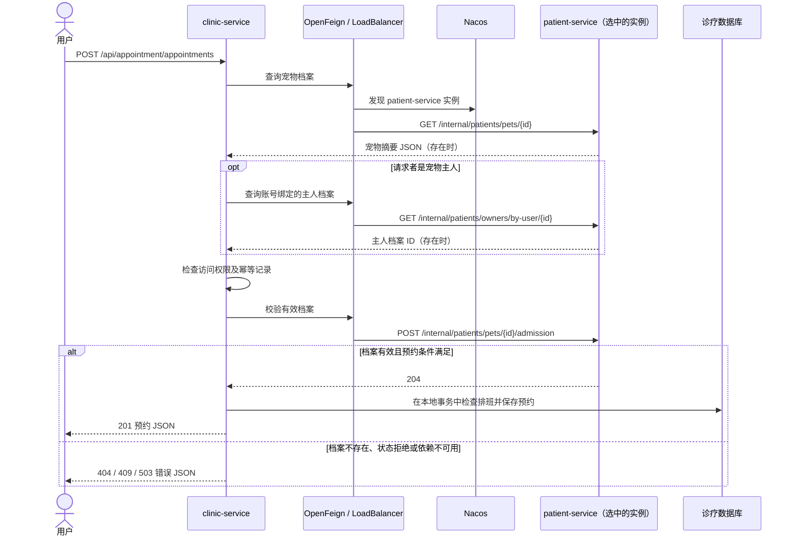

# 宠医通同步服务调用

创建预约需要患者档案服务校验宠物的存在性、归属和归档状态。档案由 `services/patient-service/` 管理，排班和预约由 `services/clinic-service/` 管理。调用方是 `clinic-service`，被调用方是 `patient-service`。

| 调用路径 | 响应 |
| --- | --- |
| `POST /api/appointment/appointments` | 成功返回 `201` 和预约 JSON，包含 `id` |
| `GET /internal/patients/pets/{id}` | 存在时返回宠物摘要 JSON，空档案由诊疗服务转换为 `404 RESOURCE_NOT_FOUND` |
| `GET /internal/patients/owners/by-user/{id}` | 主人预约时查询，存在绑定时返回主人档案 ID 的 JSON 字符串 |
| `POST /internal/patients/pets/{id}/admission` | 只读校验，成功返回 `204`，已归档返回 `409 OPERATION_NOT_ALLOWED` |

Feign 按 `patient-service` 服务名交给 Spring Cloud LoadBalancer，由 Nacos 提供实例地址。两次请求各自选址，可能落到不同实例。两实例读写同一个患者库。内部接口使用 `X-Service-Token`，默认连接超时 2 秒、读取超时 5 秒，关闭自动重试。无实例、连接失败、超时和上游 5xx 统一返回 `503 DEPENDENCY_UNAVAILABLE`。鉴权或响应异常同样以 503 失败，合法的业务错误按原状态返回。

前置校验失败时，创建预约不会进入本地写入。诊疗服务还独立调用身份服务校验医生是否可接诊，再进入本地事务。档案有效性是校验时点的结果，校验与诊疗库提交分别发生在不同服务。客户端等待预约写入响应超时时，服务端可能已提交，结果仍未知。按原请求和原 `Idempotency-Key` 重放，或查询宠物的预约列表确认结果。

部署和实测见[第 08 周记录](homework/week-08/index.md)。
